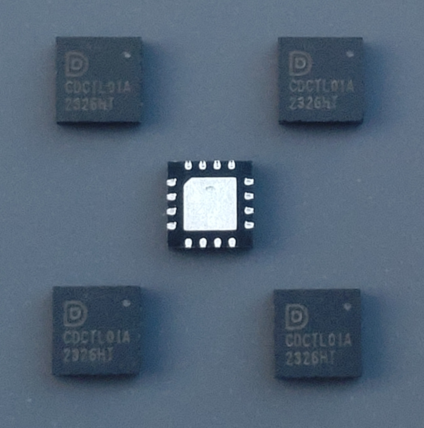
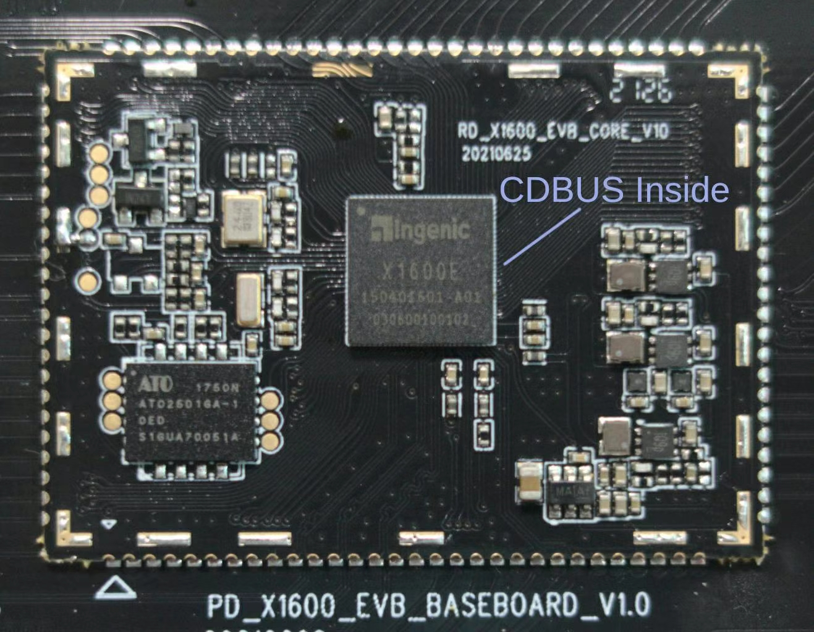

[[Chinese / 中文]](./intro_zh.md)

A Next-Generation Fieldbus: Simple, Versatile, High-Performance, Real-Time, Reliable, Open, and Low-Cost

## Multi-Master RS-485 · Up to 50 Mbps

CDBUS is based on and compatible with the UART / RS-485 protocol and hardware, introducing mechanisms like hardware packetization and arbitration. This breaks the traditional polling limitation of UART / RS-485 buses: the software layer can send and receive at any time, just like using a full-duplex serial port, with no need to worry about bus conflicts.

The CDBUS controller CDCTL01A comes in a 3x3mm QFN package, supports communication rates up to 50 Mbps (50,000,000 bps), connects to the host controller via SPI, operates in a temperature range from -40°C to 125°C, and is easy to get started with.

 

Some MCUs / CPUs also come with built-in CDBUS controllers. The CDBUS protocol is public and the IP core is open source, free for commercial use in FPGAs.

## Application Scenarios

Industrial automation, robotics, smart cities, automotive electronics, consumer electronics, modular toys, IoT, video transmission, etc.

 - **CAN and RS-485 fall short, while industrial Ethernet is too heavy**  
   Robots, especially humanoids and dexterous hands, have more and more joints and ever-higher control rates,
   and the bandwidth of CAN and traditional RS-485 can no longer keep up.
   Industrial Ethernet such as EtherCAT is too costly, bulky and complex to fit into every small joint.
   CDBUS keeps the simple hardware of RS-485 yet delivers up to 50 Mbps, filling the gap between traditional buses and industrial Ethernet.

 - **More nodes, slower polling**  
   With traditional RS-485, broadcasts usually get no replies, so the host has to query the nodes one by one and wait for each reply;
   the more bus servos or joint motors there are, the longer the control cycle.
   With CDBUS, the host sends a single broadcast or multicast packet, and all target nodes act on it in sync;
   their replies are arbitrated by hardware and sent one after another, so one request collects every reply.
   (The host side can still use traditional RS-485 hardware.)

 - **A busier bus steals more CPU from control**  
   Traditional UART / RS-485 relies on software to receive data, detect frames and check for errors,
   so even data addressed to other nodes interrupts every MCU on the bus.
   With many nodes and high baud rates, communication interrupts compete for priority with real-time tasks such as motor control:
   favor communication and the control loop jitters; favor control and data gets lost.
   CDBUS handles packetization, CRC checking and address filtering in hardware. The MCU is notified only when a complete,
   valid packet addressed to it arrives, so traffic between other nodes no longer costs any CPU time.

 - **Once the enclosure is on, the debug port is out of reach**  
   Debugging over the bus has its own catch: on traditional RS-485, debug data can only be polled by the host, one request per reply,
   so continuous data such as waveforms is hard to capture in real time. A separate debug tool would also conflict with the host.
   With CDBUS, waveform data and debug logs are reported as soon as they are generated, without conflicting with control commands,
   and you can select any one or more nodes to debug via software; a separate debug tool can also share the bus with the host.
   From system integration to field service, there is no need to open the device or to add extra debug ports and wiring.

 - **RS-485 slaves cannot report proactively, so RS-232 lives on**  
   RS-232 is short-range, slow and unsuited to bus topologies, yet RS-485 has never replaced it,
   mainly because traditional RS-485 is half-duplex and slave devices cannot send data on their own.
   CDBUS removes this limitation: devices can send and receive at any time, as with a point-to-point serial link,
   while keeping the distance, speed and multi-node advantages of RS-485.

 - **Even alarms have to wait their turn**  
   In applications with many nodes and low baud rates, such as temperature monitoring and fire alarm systems,
   a traditional RS-485 polling cycle takes a long time, and a node can only report an anomaly when its turn comes.
   With CDBUS, a node reports an event immediately, which greatly improves data collection efficiency and shortens alarm response times.

## Resource List

 - CDBUS Protocol and IP Core: https://github.com/dukelec/cdbus
 - CDCTL01A Datasheet, code examples: https://dukelec.com/en/download.html
 - CDNET: https://github.com/dukelec/cdnet  
   CDNET Protocol and CDBUS / CDNET C Library
 - CDBUS-Bridge: https://github.com/dukelec/cdbus_bridge  
   USB to RS-485 (CDBUS) Converter
 - CDSTEP: https://github.com/dukelec/cdstep  
   Stepper Motor Controller
 - CDFOC: https://github.com/dukelec/cdfoc  
   FOC Motor Controller
 - CDCAM: https://github.com/dukelec/cdcam  
   RS-485 / CDBUS JPEG Camera
 - CD-ESP: https://github.com/dukelec/cd_esp  
   BLE and WiFi UDP Gateway
 - CDPNP: https://github.com/dukelec/cdpnp  
   Compact desktop semi-automatic SMT prototyping machine
 - CDBUS-GUI: https://github.com/dukelec/cdbus_gui  
   Serial / CDBUS / CDNET GUI Tool
 - PYCDNET: https://github.com/dukelec/pycdnet  
   CDBUS / CDNET Python Library
 - CDNET-TUN: https://github.com/dukelec/cdnet_tun  
   Virtual IP/UDP network interface for CDNET
 - More resources: https://github.com/dukelec?tab=repositories

