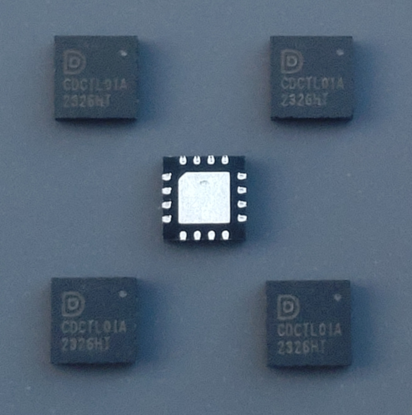
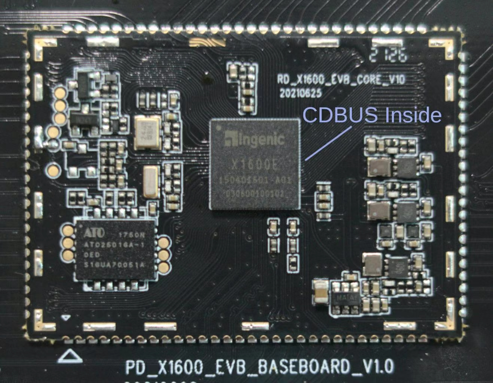

简单通用、高性能、实时可靠、开放、低成本的新一代现场总线

## 多主 RS-485 · 高达 50 Mbps

CDBUS 基于且兼容 UART / RS-485 协议和硬件，引入了 硬件分包 和 硬件仲裁 等机制，打破传统 UART / RS-485 总线只能轮询的限制：
软件层可以像使用全双工串口一样随时收发，无需担心总线冲突。

CDBUS 控制器 CDCTL01A 为 QFN 3x3mm 封装，通讯速率高达 50 Mbps (50,000,000 bps)，通过 SPI 接口连接用户主控，工作温度范围 -40~125°C，上手简单。

 

另有一些 MCU / CPU 自带 CDBUS 控制器。CDBUS 协议公开、IP 核开源，可在 FPGA 中免费商用。

## 应用场景

工业自动化、机器人、智慧城市、汽车电子、消费电子、模块化玩具、IoT 物联网、视频传输 …

 - **CAN / RS-485 不够用，工业以太网又太重**  
   机器人（尤其是人形机器人、灵巧手）关节越来越多、控制频率越来越高，CAN 和传统 RS-485 的带宽已捉襟见肘；
   而 EtherCAT 等工业以太网硬件成本高、体积大、协议栈复杂，难以塞进每一个小关节。
   CDBUS 沿用 RS-485 的简单硬件，速率却高达 50 Mbps，正好填补传统总线与工业以太网之间的空白。

 - **节点越多，轮询越慢**  
   传统 RS-485 的广播通常无法回复，主机只好逐个问、逐个等，总线舵机、关节电机一多，控制周期就被轮询拖长。
   使用 CDBUS，主机发一帧广播或组播，所有目标节点同步执行，回复由硬件自动仲裁、依次送出，一问就能全部收齐。
   （主机端仍可使用传统 RS-485 硬件。）

 - **总线越忙，通讯越跟控制抢 CPU**  
   传统 UART / RS-485 靠软件接收、判帧和校验，即便是发给其它节点的数据，也会打断总线上的每一个 MCU。
   节点多、速率高时，通讯中断与电机控制等实时任务争抢优先级：通讯优先则控制抖动，控制优先则通讯丢数据。
   CDBUS 由硬件完成分包、校验和地址过滤，只有发给自己且校验正确的整包才会通知 MCU，其它节点的收发不再占用 CPU。

 - **装上外壳，调试口就够不着**  
   只能改用通讯总线调试，而传统 RS-485 靠主机一问一答地轮询，难以实时获取波形这类连续数据，独立的调试工具还会和主机冲突。
   使用 CDBUS，波形数据和调试日志一产生就主动上报，与控制命令互不冲突，可软件选择调试任意一个或多个节点；独立的调试工具也可以和主机同时接在总线上。
   从研发联调到售后维护，无需拆机，也无需额外的调试接口和线束。

 - **RS-485 从机不能主动上报，RS-232 迟迟无法淘汰**  
   RS-232 距离短、速度低、不便组网，却一直没被 RS-485 取代，主要因为传统 RS-485 是半双工，从机不能主动发送数据。
   CDBUS 打破了这一限制，设备可以像点对点串口一样随时收发，同时享有 RS-485 的距离、速度和多节点优势。

 - **报警也要排队等轮询**  
   温度采集、消防系统等节点多、速率低的应用，传统 RS-485 轮询一圈耗时很长，异常只能等轮到自己才能上报。
   改用 CDBUS，有事件的节点立即主动上报，可以大幅提升采集效率、缩短报警响应时间。

## 资源列表

 - CDBUS 协议及 IP 核: https://github.com/dukelec/cdbus
 - CDCTL01A 数据手册、示例代码: https://dukelec.com/en/download.html
 - CDCTL01A 芯片 FAQ: https://github.com/dukelec/cdbus_doc/wiki/CDCTL01A-芯片-FAQ-中文版  
 - CDNET 协议及代码库: https://github.com/dukelec/cdnet
 - CDBUS-Bridge: https://github.com/dukelec/cdbus_bridge  
   USB 转 RS-485 (CDBUS)
 - CDSTEP: https://github.com/dukelec/cdstep  
   步进电机控制器
 - CDFOC: https://github.com/dukelec/cdfoc  
   FOC 无刷电机控制器
 - CDCAM: https://github.com/dukelec/cdcam  
   RS-485 / CDBUS JPEG 摄像头
 - CD-ESP: https://github.com/dukelec/cd_esp  
   蓝牙 BLE 和 WiFi UDP 网关
 - CDPNP: https://github.com/dukelec/cdpnp  
   半自动桌面贴片机
 - CDBUS-GUI: https://github.com/dukelec/cdbus_gui  
   Serial / CDBUS / CDNET 图形界面上位机工具
 - PYCDNET: https://github.com/dukelec/pycdnet  
   CDBUS / CDNET Python 库
 - CDNET-TUN: https://github.com/dukelec/cdnet_tun  
   用于 CDNET 的 IP/UDP 虚拟网口
 - 更多资源: https://github.com/dukelec?tab=repositories

